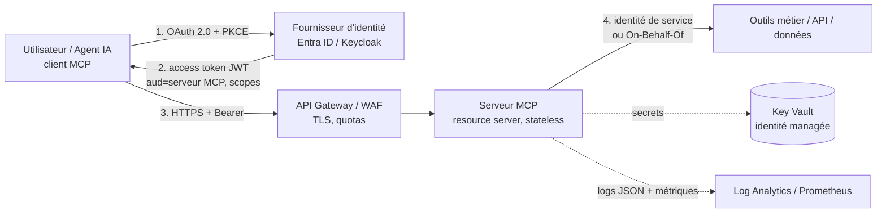

# Architecture cible

## Vue d'ensemble

## Décisions et arbitrages

| Sujet | Choix | Pourquoi / alternative écartée |
|---|---|---|
| Transport | Streamable HTTP, **stateless** | Scalable derrière un load balancer, pas d'affinité de session. `stdio` réservé au poste dev (pas d'auth réseau). SSE seul est déprécié. |
| Rôle du serveur MCP | **Resource server** OAuth uniquement | Il valide les tokens, n'en émet pas. L'IdP de l'entreprise reste la source de vérité (SSO, MFA, révocation). |
| Validation du token | Signature (JWKS), `exp`, `iss`, **`aud` = ce serveur**, liste blanche d'algorithmes | Évite les tokens destinés à une autre API et les attaques `alg=none`. |
| Appels aval | Identité de service (lecture partagée) ou **On-Behalf-Of** (droits de l'utilisateur) | **Pas de token passthrough** : on ne retransmet jamais le token reçu à une API aval. |
| Autorisation | Scopes par outil (`tickets:read`, `tickets:write`) + contrôle côté outil | Moindre privilège ; les outils d'écriture sont séparés des outils de lecture. |
| Découverte | `/.well-known/oauth-protected-resource` (RFC 9728) + `WWW-Authenticate` | Le client MCP découvre seul l'IdP à utiliser. |
| Secrets | Key Vault + identité managée ; jamais dans l'image ni le dépôt ; rotation 90 j | `.env` uniquement en dev. |
| Entrées | Validation stricte (regex, enums, longueurs) | Un agent IA peut envoyer des arguments imprévus : traiter comme entrée non fiable. |
| Réseau | Protection DNS rebinding (Host/Origin autorisés), TLS à la gateway | Évite l'appel du serveur par une page web malveillante. |
| Débit | Rate limit par `sub` | En mémoire ici ; Redis / API Gateway en multi-réplicas. |

## Risques spécifiques à l'IA générative (à connaître)

- **Injection de prompt via les résultats d'outils** : un ticket ou un document peut contenir des instructions. Le serveur ne peut pas le résoudre seul : limiter les outils d'écriture, confirmation humaine pour les actions sensibles, ne pas exposer plus que nécessaire.
- **Excès de permissions** : un agent qui dispose d'un outil destructeur finira par l'appeler. Séparer lecture / écriture, scopes distincts.
- **Fuite de données** : ne pas journaliser les valeurs d'arguments ni les résultats (le projet journalise seulement les *noms* d'arguments).
- **Serveurs MCP tiers** : chaque serveur externe est une chaîne d'approvisionnement : revue, épinglage de version, allowlist.

## Environnements et déploiement

| | Dev | Test / recette | Production |
|---|---|---|---|
| Identité | IdP de dev ou `mint_token.py` | Tenant de test, comptes de test | IdP d'entreprise |
| Secrets | `.env` local | Key Vault test | Key Vault prod, accès par identité managée |
| Déploiement | `python server.py` | Pipeline CI → conteneur | Pipeline CI/CD, déploiement progressif (blue/green), rollback |
| Données | Factices | Jeu anonymisé | Réelles, droits minimaux |

Pipeline : tests → analyse statique (`bandit`) → audit des dépendances (`pip-audit`) → build image → déploiement. Image non-root, sans secret.

## Supervision

- Journal d'audit JSON : `event`, `tool`, `sub`, `scope`, `outcome` (ok / denied / error), durée.
- Métriques à suivre : taux de 401/403, latence p95 par outil, taux d'erreur, appels par utilisateur.
- Alertes : pic de refus d'authentification, outil d'écriture appelé hors horaires, dépassement de quota.
- `/health` pour les sondes liveness/readiness.

## Évolutivité

Stateless + conteneur → ajout de réplicas sans état partagé. Un connecteur = un module avec ses scopes ; pour beaucoup de connecteurs, un serveur MCP par domaine métier (isolation des droits et des pannes) plutôt qu'un monolithe.
